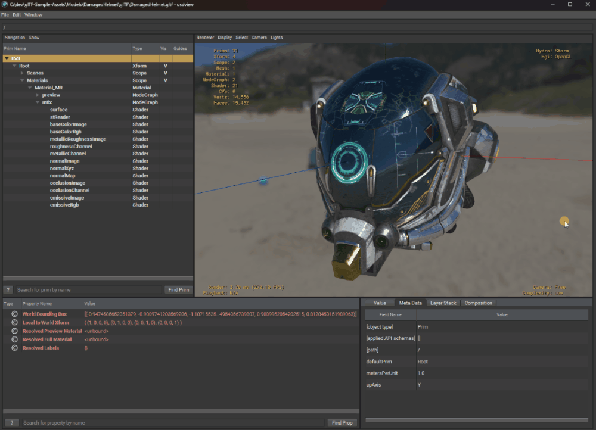
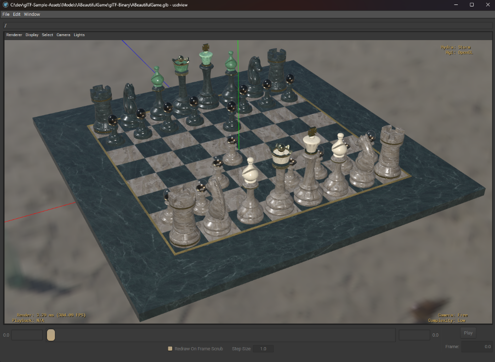
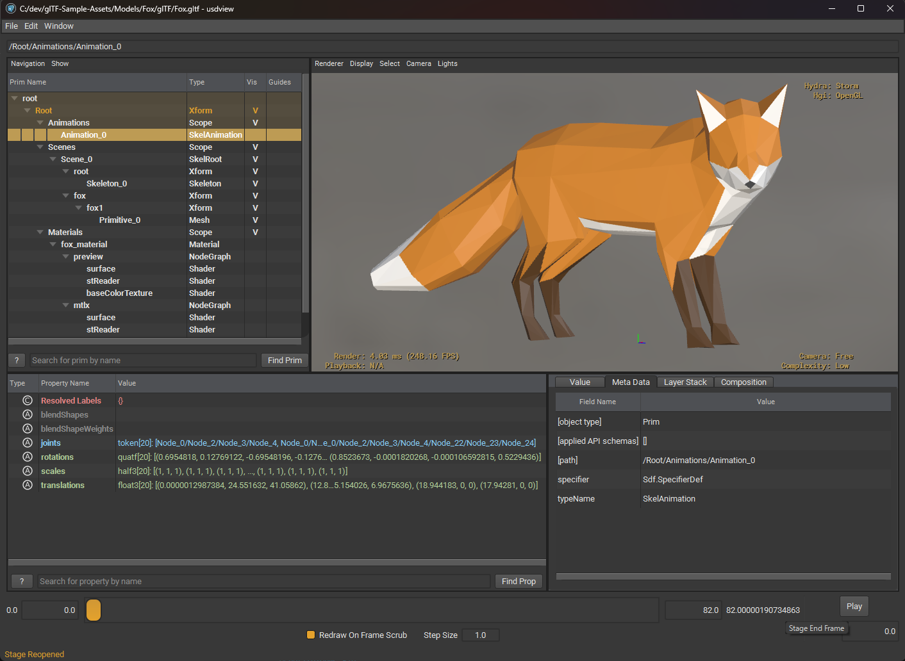
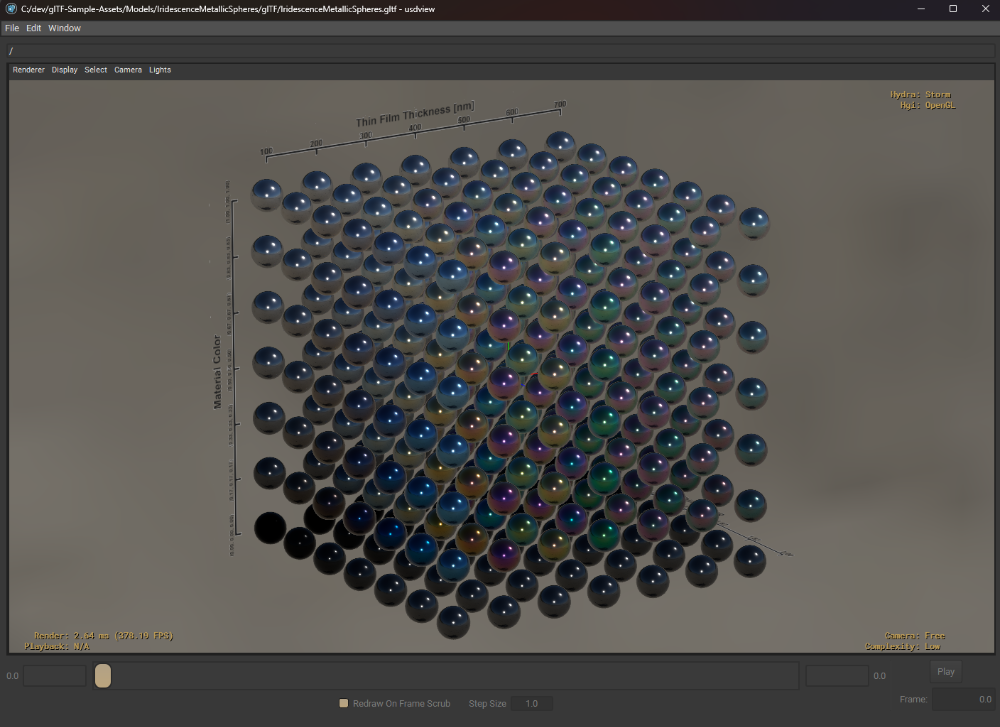
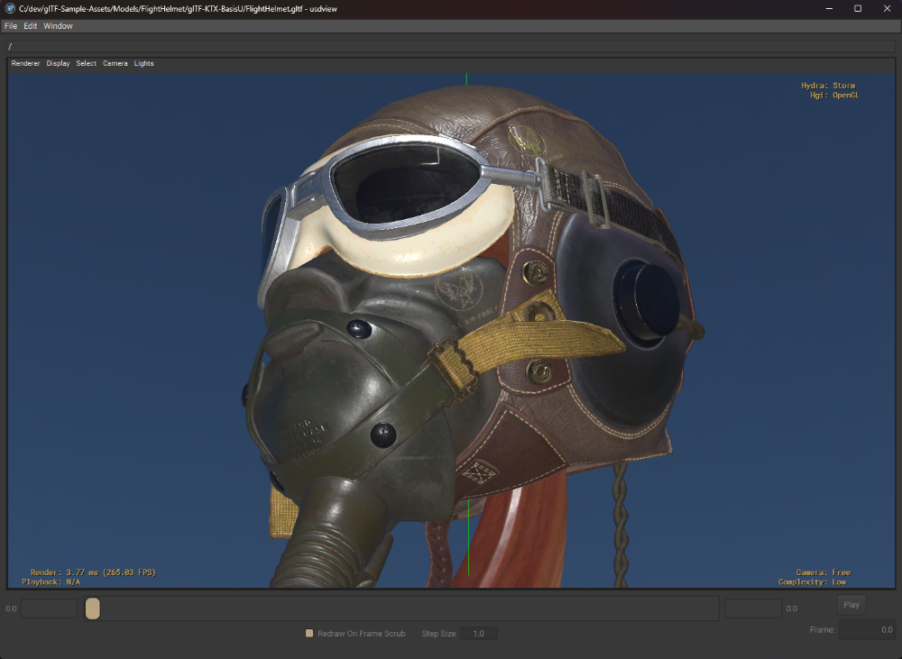

# OpenUSD glTF Plugins

**Open glTF and GLB files directly as OpenUSD stages.**

[](https://github.com/animu-sphere/usd-gltf-plugins/actions/workflows/ci.yml?query=branch%3Amain)
[](LICENSE)



## Overview

An [OpenUSD](https://openusd.org/) file format plugin for reading
[Khronos glTF 2.0](https://www.khronos.org/gltf/) (`.gltf` and `.glb`)
directly in usdview and other OpenUSD tools. It recreates
supported scene hierarchies, meshes, materials and textures, cameras, lights,
animation, skinning and morph targets using standard USD schemas, with no
custom USD schema or imaging plugin required.

An independent [OpenStrata Project](https://github.com/animu-sphere/open-strata)
repository, powered by fastgltf. Some features are experimental and appearance
depends on the renderer; see the
[capability matrix](docs/reference/CAPABILITY_MATRIX.md) for supported features
and limitations.

## Quick start

Build and install the plugin with CMake 3.22 or newer, a C++20 compiler, and an
OpenUSD development installation with its Python modules. fastgltf and its
dependencies are [vendored](third_party/README.md); CMake does not download them.

```sh
cmake -S . -B build -DCMAKE_PREFIX_PATH=<openusd-prefix>
cmake --build build --config Release
cmake --install build --config Release --prefix <install-prefix>
```

Set `PXR_PLUGINPATH_NAME` to
`<install-prefix>/plugin/resources/usdGltfFileFormat` so OpenUSD can discover
the installed plugin. Then open a model in usdview:

```sh
usdview path/to/model.glb
```

Or open it from Python:

```python
from pxr import Usd

stage = Usd.Stage.Open("model.glb")
print(stage.GetDefaultPrim().GetPath())  # /Root
```

See the [development guide](docs/DEVELOPMENT.md) for other build and test
workflows.

## Gallery

**A Beautiful Game** — a glTF scene in usdview.



**Fox** — explore an imported scene, skeleton, animation and materials in the
USD Stage Tree.



**Iridescence Metallic Spheres** — a material test scene in usdview.



**Flight Helmet** — textured materials in usdview, using KTX2 (Basis Universal)
textures.



These are captures, not general rendering-fidelity guarantees. Appearance and
material support depend on the renderer; see the
[capability matrix](docs/reference/CAPABILITY_MATRIX.md) and
[showcase credits and capture notes](docs/images/showcase/README.md).

## Compatibility and limitations

The plugin is read-only and in early development. Many real-world assets are
rejected with a diagnostic, and rendering may differ between delegates.
The [capability matrix](docs/reference/CAPABILITY_MATRIX.md) is the
authoritative source for supported features, limitations, evidence, and tested
environments.

## Documentation

- [Documentation index](docs/README.md)
- [Development guide](docs/DEVELOPMENT.md)
- [Workspace architecture](docs/architecture/WORKSPACE.md)
- [Implementation policy](docs/design/IMPLEMENTATION_POLICY.md)
- [Roadmap](docs/roadmap/README.md)
- [Changelog](CHANGELOG.md)

## Contributing

See the [contributing guide](CONTRIBUTING.md) and the
[Code of Conduct](CODE_OF_CONDUCT.md). Please report vulnerabilities privately
as described in the [security policy](SECURITY.md).

## License and asset credits

The project is licensed under the [Apache License 2.0](LICENSE). Vendored
dependency licenses are in the [third-party notices](third_party/NOTICES.txt).
Both are installed under `share/licenses/usd-gltf-plugins`.

Showcase images depict third-party models with their own licenses, including
non-commercial terms for Damaged Helmet. See
[showcase credits](docs/images/showcase/README.md) before reusing them.
